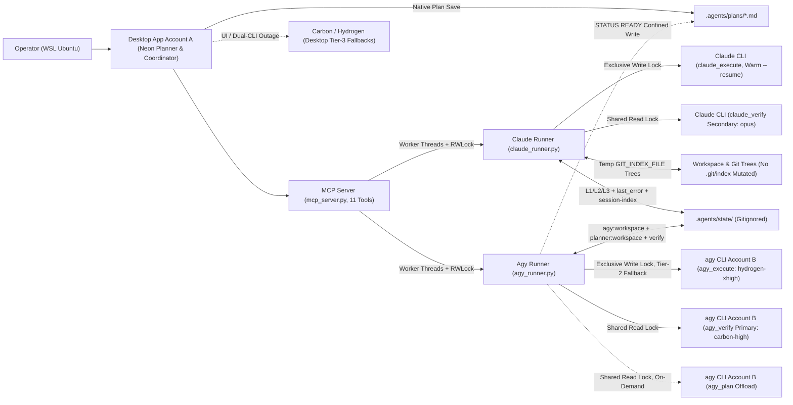
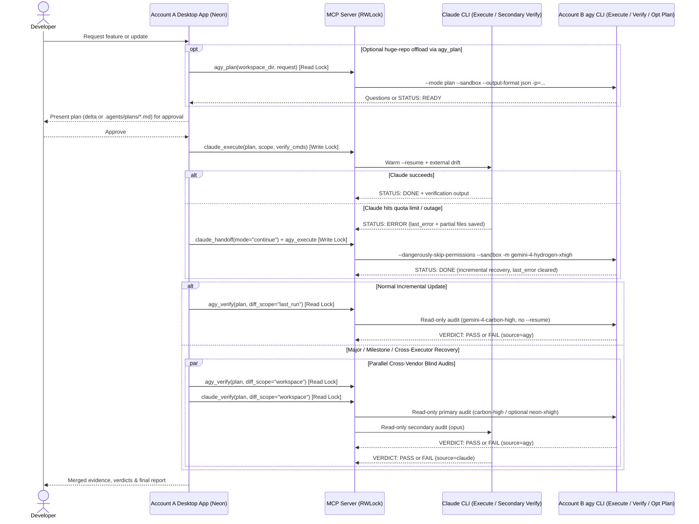
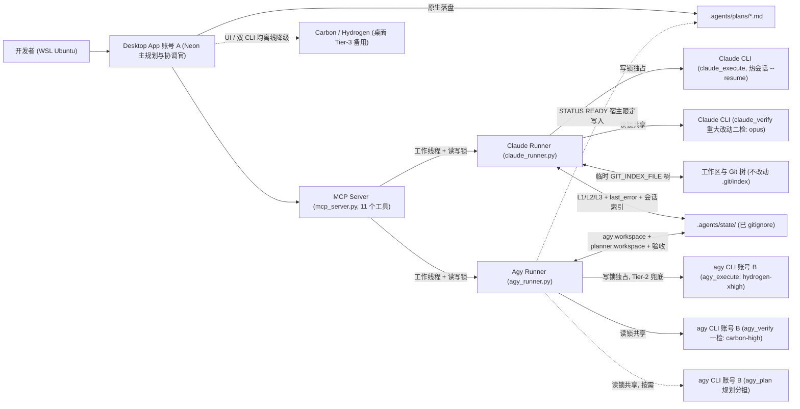
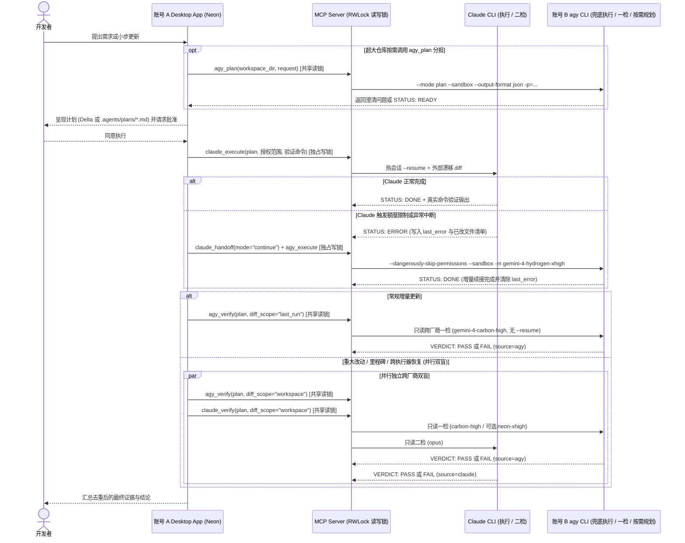

[English](#english) | [中文](#中文)

---

<a id="english"></a>

# ai-teams — Multi-Agent Coding & Cross-Vendor Blind Code Review for Google Antigravity & Claude Code


**`ai-teams`** is a **zero-dependency Model Context Protocol (MCP) server, `GEMINI.md` rule kit, and multi-agent coding workflow** that unites **Google Antigravity IDE (`agy` CLI)**, **Anthropic Claude Code CLI (`claude`)**, and **Anthropic-compatible APIs (DeepSeek, OpenRouter, LiteLLM)** into an automated **Plan -> Execute -> Cross-Vendor Blind Code Review -> Quota-Failover** engineering team across **WSL2 (Ubuntu), Linux, macOS, and Windows PowerShell**.

Instead of letting a single LLM write and review its own code—or stalling mid-feature when a subscription hits rate limits—`ai-teams` routes planning, unattended coding, independent cross-model code review, and interrupted-run recovery across accounts and vendors with one drop-in install command.

- **Account A (Desktop App, Gemini 4 Neon — Planner & Coordinator):** Drives human conversation, native codebase planning (direct chat or `/plan` writing `.agents/plans/*.md`), MCP orchestration, double-blind deduplication, and final summaries.
- **Claude Code CLI (`claude_execute*` / `claude_verify` — Primary Executor & Major-Change Secondary Auditor):** Unattended implementation (`Sonnet 5.5` or third-party Anthropic-compatible endpoints such as DeepSeek `deepseek-flash[1m]` / `deepseek-v4-pro[1m]`) on a warm `"workspace"` session, plus parallel read-only `claude_verify` (`opus`) on major/milestone/high-risk changes and automatic primary-audit fallback if `agy` is unavailable.
- **Account B (`agy` CLI via MCP `agy_*` — Primary Blind Auditor, Tier-2 Fallback Executor & Optional Planner):** Runs routine primary cross-vendor blind auditing via `agy_verify` (`AGY_VERIFY_MODEL="gemini-4-carbon-high"`), provides **incremental Account B fallback execution** via `agy_execute` (`AGY_EXECUTE_MODEL="gemini-4-hydrogen-xhigh"`) when Claude hits token/plan limits or outages without spending Account A quota, and offers optional on-demand `agy_plan` offloading for huge repository scans.

> **What's New in v2.5.2:** Fixed headless read-only shell checks in `agy_verify` / `agy_plan`, raised Claude turn budgets (`40` / `25`) with `error_max_turns` resume caching, enabled zero-`__pycache__` MCP startup (`python3 -B`), and tightened verifier anti-fabrication guardrails — [see full release notes](#version-evolution--roadmap).

### Why ai-teams?

- **Cross-Vendor Double-Blind Code Review (No Self-Grading Blind Spots):** Routine edits are audited read-only by Google Gemini (`agy_verify`), while major/high-risk/PR changes run `agy_verify` + `claude_verify` (Claude Opus) **in parallel** under shared read locks.
- **Automatic Quota Failover & Incremental Resume:** When Claude Code hits rate limits, 5-hour usage caps, or outages mid-task, `ai-teams` records `last_error` and partial disk edits (`Interrupted Run Recovery`) so Account B (`agy_execute`) finishes incrementally without spending primary IDE quota.
- **Zero-Dependency Python 3 MCP Server (11 Tools):** Built strictly on the Python 3 standard library (`0` `pip` or `npm` packages). Runs on the host over stdio to eliminate IDE sandbox permission prompts, backed by per-workspace RWLock concurrency and full child process-tree cancellation.
- **Token-Frugal Session Continuity & Non-Invasive Git Checkpoints:** Warm `--resume` sessions, automatic external-edit drift injection, a `<= 2 KB` L1 workspace brief + L1/L2/L3 progressive state cache, and zero-LLM `claude_handoff` packets — paired with temporary `GIT_INDEX_FILE` tree snapshots and CLI-only `--rollback` (zero `.git/index` mutation).
- **One-Command Non-Intrusive Drop-In:** Initialize or upgrade any repository in seconds via `init-ai-team.sh` (WSL2 / Linux / macOS) or `init-ai-team.ps1` (Windows PowerShell). Wrapper scripts stay confined to `.agents/scripts/`, and an idempotent `.gitignore` block keeps `.agents/` and `GEMINI.md` out of project commits.

### Contents (English)

- [Why ai-teams?](#why-ai-teams)
- [30-Second Quick Start](#30-second-quick-start)
- [System Architecture](#system-architecture)
- [Core Principles & Internal Mechanisms](#core-principles--internal-mechanisms)
- [Planning Methodology & Workflows](#planning-methodology--workflows)
- [Multilingual Team Support](#multilingual-team-support)
- [Directory Structure](#directory-structure)
- [Model Routing & 11 MCP Tools](#model-routing--11-mcp-tools)
- [Engineering & Safety Guardrails](#engineering--safety-guardrails)
- [Standalone CLI Testing, Initialization & Upgrading Existing Projects](#standalone-cli-testing-initialization--upgrading-existing-projects)
- [Startup Checklist (Antigravity Desktop App)](#startup-checklist-antigravity-desktop-app)
- [Version Evolution & Roadmap](#version-evolution--roadmap)

### 30-Second Quick Start

**Prerequisites:** Python 3.9+, Git, Claude Code CLI (`claude`, or an Anthropic-compatible endpoint such as DeepSeek), and the Google Antigravity Desktop App + `agy` CLI (`WSL2` / Linux / macOS; Windows PowerShell supports the full Claude workflow).

```bash
# WSL2 / Linux / macOS — install into your project, switch into it, then run zero-cost preflight checks
./scripts/init-ai-team.sh /path/to/your-project
cd /path/to/your-project
./.agents/scripts/claude-exec.sh --healthcheck --workspace .
./.agents/scripts/agy-exec.sh --healthcheck --workspace .
```

```powershell
# Windows PowerShell — install into your project, switch into it, then run the Claude preflight check
.\scripts\init-ai-team.ps1 -TargetDir "C:\path\to\your-project"
cd "C:\path\to\your-project"
.\.agents\scripts\claude-exec.ps1 -Healthcheck -Workspace .
```

See [Standalone CLI Testing, Initialization & Upgrading Existing Projects](#standalone-cli-testing-initialization--upgrading-existing-projects) for `--force` / `-Force` in-place upgrades, `--no-git-init` / `-NoGitInit`, every CLI flag, and exit codes.

### System Architecture



**Runtime Concurrency & Process Isolation:**
- **Host-side MCP stdio (zero sandbox friction):** Antigravity spawns `mcp_server.py` directly on the WSL host outside the terminal sandbox, so both local `~/.claude` and `~/.gemini/antigravity-cli` work natively without interactive prompts.
- **Per-workspace RWLock (`JobManager`):** Write operations (`claude_execute`, `claude_execute_start`, `agy_execute`, CLI `--rollback`) acquire an exclusive write lock; read-only operations (`claude_verify`, `agy_plan`, `agy_verify`) acquire shared read locks — letting **`agy_verify` and `claude_verify` run concurrently** in double-blind mode while blocking any concurrent write (`status: "BUSY"`, `active_job_id`).
- **Unified async polling & cancellation:** When deep scans, fallback runs, or large audits need > `165s`, `claude_execute_start` as well as `agy_plan`, `agy_execute`, and `agy_verify` with `async_mode: true` return `STARTED` + `job_id` and share `claude_execute_status` / `claude_execute_cancel` (OS process-group `SIGTERM -> SIGKILL` across the full child tree).
- **Empty-string input validation:** Explicit `""` passed to `mode` or `diff_scope` returns a validation error (`isError: true`) instead of silently falling back to defaults.

### Core Principles & Internal Mechanisms

#### 1. Dual-Account & Multi-Engine Quota Economics

- **Account A (Desktop App):** Handles native codebase planning, fluent human-in-the-loop alignment, MCP orchestration, double-blind deduplication, and browser UI verification.
- **Account B (`agy` CLI):** Absorbs **routine primary cross-vendor blind auditing** via `agy_verify` (default `AGY_VERIFY_MODEL="gemini-4-carbon-high"`), **Tier-2 fallback execution** via `agy_execute` (default `AGY_EXECUTE_MODEL="gemini-4-hydrogen-xhigh"`, omitting `--mode` and keeping `AGY_EFFORT=""` because `agy 1.5.18` model slugs already encode reasoning tiers such as `-high`/`-xhigh`), plus **optional on-demand `agy_plan`** offloading for huge repo scans.
- **Local `claude` CLI:** Primary unattended code executor (`sonnet`) and parallel secondary double-blind auditor (`opus`) on major/milestone/high-risk changes (as well as primary audit fallback if `agy` is down) — compatible with both official Claude subscriptions and Anthropic-compatible endpoints such as DeepSeek.

#### 2. Optional `agy_plan` Offload: Clarify-Resume Loop & Safe Host Persistence

When offloading a large repository scan or conserving Account A quota via optional `agy_plan`, headless CLI agents cannot pop up interactive dialogs mid-turn, so `agy_plan` enforces a strict structured contract:
1. **Verified `agy 1.5.18` CLI invocation:** Passes `--mode plan --output-format json --print-timeout <N>s --sandbox -p=<prompt>` (with optional `--model`, `--effort`, `--resume`). Notice `--disable-slash-commands` is intentionally **omitted** because in `agy 1.5.18` disabling slash commands disables `--mode plan`; instead, every prompt starts with a Markdown `## ...` header so it never starts with `/`. Prompt size is automatically capped under `96,000` UTF-8 bytes so WSL Linux `ARG_MAX` limits are never tripped.
2. **Warm planner session (`planner:workspace`) & external drift:** Subsequent requests reuse `conversation_id` under `session_key="planner:workspace"` and inject `External Workspace Changes Since Your Last Turn` whenever files changed externally between planning turns.
3. **Structured status protocol (line 1, fail-closed):**
   - `STATUS: NEED_CLARIFICATION` (at most 3 targeted questions) -> Account A relays questions to the operator -> operator replies -> Account A resumes via `agy_plan(session_mode="resume", ...)` until ready.
   - `STATUS: READY` -> ready plan (2-5 line delta for small updates, or step-by-step plan for larger features).
   - `STATUS: BLOCKED` -> missing specs, files, or access checklist.
4. **Strict read-only + host-managed `save_plan_file`:** During `agy` execution, `_snapshot_workspace()` guards the entire repository (`read_only_violation: true` fails immediately). Only when `STATUS: READY` completes cleanly with zero mutations does **host Python** atomically write optional `save_plan_file`, and `_validate_save_plan_file()` guarantees paths stay strictly inside `.agents/plans/` (rejecting `..`, outside files, or symlink escapes).

#### 3. Hot-Session Continuity, External Drift & Interrupted-Run Recovery (`claude_execute*` -> `agy_execute`)

- **Workspace-keyed hot sessions (`"workspace"` / `"agy:workspace"`):** Sequential small updates and new `plan_file` inputs stay on one warm Claude `--resume` session (`"workspace"`, `rotated_plan_changed` is removed), while Account B `agy_execute` keeps its own isolated warm bucket (`"agy:workspace"`). Rotation happens only on TTL (`3600s`), `30` cumulative turns, `session_mode: "fresh"`, or a custom `session_key`, with `fallback_fresh` auto-recovery if an upstream session expires.
- **Non-invasive Git tree checkpoints (`pre_run_tree` / `post_run_tree`):** Captured via throwaway `GIT_INDEX_FILE` temp indexes excluding `.agents/state/` and respecting `.gitignore` — zero changes to `.git/index`, zero hidden commits/branches.
- **Incremental continuation after Claude failure:** If `claude_execute*` hits a rate limit, quota exhaustion, or mid-run error (`ERROR`) on a workspace with state or partial disk edits (`run_changed_files`), the host records `state.json["last_error"]` without clobbering the previous successful `checkpoint`, and renders `## Interrupted Run Recovery` in `workspace-brief.md` + `claude_handoff(mode="continue")`. **`agy_execute`** (`gemini-4-hydrogen-xhigh`) resumes **incrementally** from the files already on disk, clears `last_error` on `DONE`, and archives `runs/exec-agy-*.md`; once Claude recovers, Claude's next `--resume` automatically receives `agy_execute`'s changes via `External Workspace Changes Since Your Last Turn`.

#### 4. L1 / L2 / L3 Progressive Local State & Zero-LLM Portable Handoff (`claude_handoff`)

| Tier | File(s) | Retention / Byte Budget | Contents & Purpose |
| :--- | :--- | :--- | :--- |
| **L1** | `state.json` + `workspace-brief.md` | Brief strictly `<= 2048` bytes (UTF-8) | Checkpoint (`goal`, `status`, `plan_file`, `session_key`, `pre_run_tree`, `post_run_tree`, `verdicts`), `last_error` recovery info (if interrupted), active artifact & symbol map (Python/JS/TS/Go/Rust, deleted files auto-pruned), and source-isolated `open_issues_by_source` + merged `open_issues` |
| **L2** | `plan-history.md` | Rolling cap of `10` entries | Compact 4-line ledger entries with `Details:` L3 pointers. Cold/rotated runs inject **L1 + latest 2 L2 entries** (`<= 3072` bytes) |
| **L3** | `runs/<run_id>.md` | Rolling cap of `20` files | Full execution (`exec-*.md` / `exec-agy-*.md`) and verification (`verify-*.md` / `verify-agy-*.md`) logs — **0 prompt tokens** unless read or matched by `claude_handoff` |
| **Index** | `session-index.json` | Keyed by `session_key` | Separate buckets for `"workspace"` (Claude), `"agy:workspace"` (`agy_execute`), and `"planner:workspace"` (`agy_plan`) |

Zero-LLM MCP tool **`claude_handoff`** (strictly read-only; never creates `.agents/state/`) renders budgeted UTF-8 packets (`512..12288` bytes, default `3072`) for `mode: "continue" | "fix_review" | "new_plan"` (including `## Interrupted Run Recovery` when `last_error` is active) plus case-insensitive `search_query` across L1/L2/L3.

#### 5. Tiered Cross-Vendor Blind Verification & Source-Isolated State (`agy_verify` + `claude_verify`)

- **Tiered trigger policy:**
  - *Trivial edits* (typos, comments, formatting): skip formal verifier; run quick syntax/build check.
  - *Normal / incremental updates:* **`agy_verify`** (`AGY_VERIFY_MODEL="gemini-4-carbon-high"`, `AGY_EFFORT=""`) with default **`diff_scope: "last_run"`** (diffs current temp-index tree against `pre_run_tree`, including new untracked files and excluding older pre-existing dirty files; falls back to `"workspace"` if non-git/no checkpoint and returns `resolved_diff_scope`; pass `async_mode=true` for large diffs that could exceed `150s`). This gives automatic cross-vendor auditing without spending Account A quota.
  - *Major changes / milestones / pre-commit / pre-PR / high-risk / user-requested double checks:* Launch **`agy_verify` + `claude_verify` (`opus`) in parallel** under RWLock shared read locks (optionally override `agy_verify(model="gemini-4-neon-xhigh")` when deepest Gemini reasoning is desired), mutually blind (neither sees executor self-reports or the other verifier's report), and deduplicate findings in the main session (Account A). After an interrupted fallback recovery handoff across executors (`claude_execute` -> `agy_execute`), pass `diff_scope="workspace"` so both partial and resumed edits are audited together.
  - *Outages & browser UI:* If `agy` is unavailable/rate-limited, fall back to **`claude_verify`** (`opus`); delegate interactive browser UI checks or dual-CLI outages to **`carbon-verifier`** directly in Antigravity.
- **Source-isolated `open_issues_by_source`:** Both `agy_verify` (`source="agy"`) and `claude_verify` (`source="claude"`) **never create `.agents/state/`** on a clean workspace. Only when `.agents/state/` already exists and `read_only_violation` is `False` does host Python update `open_issues_by_source[source]`, rebuild deduplicated `open_issues` (`[agy]` / `[claude]` prefixed whenever both sources have active issues), set `checkpoint.status="done"` only when no active issues remain, and archive `runs/verify-*.md`.

#### 6. Safe CLI-Only Rollback (`--rollback` / `-Rollback`)

Rollback stays strictly **CLI-only** (never an MCP tool): requires Git repo root, acquires RWLock write lock, restores `M`/`D`/`T` files from `pre_run_tree` via a throwaway temp index and deletes run-added `A` files + emptied subdirs while preserving `.git/index`, `.agents/state/`, and gitignored files (e.g. `.env`), then invalidates matching sessions and sets checkpoint `rolled_back`.

### Planning Methodology & Workflows

#### Task Sizing & Routing Matrix

| Task Class | Planner & Format | Executor & Session Policy | Verifier Policy |
| :--- | :--- | :--- | :--- |
| **Tiny 1-2 line wording fix** | Skip planner or minimal check | Direct main-session edit (or `claude_execute`) | Quick syntax/build check |
| **Small incremental update** | **Desktop App Neon** -> 2-5 line delta plan (no file needed) | **`claude_execute`** (`session_key="workspace"`, `session_mode="auto"`) | **`agy_verify`** (`gemini-4-carbon-high`, `diff_scope="last_run"`) |
| **Multi-step feature** | **Desktop App Neon** (`.agents/plans/<nn>-<topic>.md`) or optional `agy_plan` offload | **`claude_execute`** / `claude_execute_start` (`plan_file=...`) | **`agy_verify`** per step (`last_run`), parallel **`claude_verify`** (`opus`) at milestone (`workspace`) |
| **Ambiguous requirements** | **Desktop App Neon** asks <= 3 questions directly (or `agy_plan` `NEED_CLARIFICATION`) | Wait for user confirmation & approval | Tiered per risk |
| **Fix round after `FAIL`** | Reference active `open_issues_by_source` | **`claude_execute`** (or `agy_execute` if limited, `session_mode="resume"`, max 3 rounds) | Re-verify failing source(s) (`agy_verify` / `claude_verify`) |
| **Major / high-risk / pre-commit / PR** | **Desktop App Neon** (`STATUS: READY`) + security DoD | **`claude_execute`** | **Parallel double-blind:** `agy_verify` (`carbon-high` or `neon-xhigh`) + `claude_verify` (`opus`, `diff_scope="workspace"`) |
| **Claude quota limit / dual outage / UI** | Native Neon / `claude_handoff(mode="continue")` | **Tier-2:** **`agy_execute`** (`gemini-4-hydrogen-xhigh`); **Tier-3:** `hydrogen-executor` | `diff_scope="workspace"` after cross-executor recovery; `claude_verify` / **`carbon-verifier`** on outage/UI |

#### Dual-Account Relay Sequence



### Multilingual Team Support

All rules (`GEMINI.md`), custom agent definitions (`.agents/agents/*.md`), Python modules, and shell/PowerShell wrappers are written in **pure ASCII English** to minimize prompt tokens and avoid locale/encoding hazards. Meanwhile, `GEMINI.md` and every agent prompt enforce a **user-language reply rule**: structured machine tags (`STATUS: READY|NEED_CLARIFICATION|DONE|BLOCKED`, `VERDICT: PASS|FAIL|BLOCKED`) stay in English while explanations match the teammate's language, and runtime `.agents/state/` files preserve UTF-8 multilingual summaries cleanly.

### Directory Structure

```text
.
├── .gitignore                                     # Managed ignore block (.agents/ & GEMINI.md; auto-added)
├── GEMINI.md                                      # Dual-account 4-step rules, routing, continuity & guardrails
├── .agents/
│   ├── agents/
│   │   ├── claude-executor.md                     # 1. Claude / Agy Executor Dispatcher (model: flash_lite)
│   │   ├── hydrogen-executor.md                   #    Tier-3 Account A Hydrogen Fallback (model: flash)
│   │   ├── opus-verifier.md                       # 2. Agy / Opus Blind Verifier Dispatcher (model: flash)
│   │   └── carbon-verifier.md                     # 2. Carbon Verifier (UI / outage fallback, model: pro)
│   ├── plans/                                     # Optional saved plans (Desktop App or agy_plan save_plan_file)
│   ├── scripts/                                   # Deployed inside .agents/scripts/ to never collide with repo scripts/
│   │   ├── claude-exec.sh                         # WSL / Linux / macOS Claude execute/verify/handoff/rollback CLI
│   │   ├── claude-exec.ps1                        # Windows PowerShell Claude execute/verify/handoff/rollback CLI
│   │   └── agy-exec.sh                            # WSL / Ubuntu standalone agy verify/execute/plan CLI wrapper
│   ├── state/                                     # Auto-created local continuity cache (gitignored via *)
│   │   ├── .gitignore                             # Ignores all runtime cache files (*)
│   │   ├── state.json                             # L1 checkpoint, last_error, artifacts, open_issues_by_source
│   │   ├── workspace-brief.md                     # L1 compact UTF-8 workspace brief (<= 2KB)
│   │   ├── plan-history.md                        # L2 rolling ledger (latest 10 compact entries)
│   │   ├── runs/                                  # L3 full logs (exec-*.md, exec-agy-*.md, verify-*.md; cap 20)
│   │   └── session-index.json                     # Hot session index ('workspace', 'agy:workspace', 'planner:workspace')
│   └── plugins/
│       └── claude-executor/
│           ├── plugin.json                        # Antigravity plugin manifest (v2.5.2)
│           ├── mcp_config.json                    # MCP stdio entrypoint (AGY_VERIFY_MODEL + AGY_EXECUTE_MODEL)
│           ├── claude_runner.py                   # RWLock, git tree checkpoints, L1/L2/L3, Claude runner/verifier
│           ├── agy_runner.py                      # Account B agy CLI primary verifier, fallback executor & planner
│           └── mcp_server.py                      # Non-blocking multi-threaded MCP server (11 tools)
├── scripts/                                       # Template deployer scripts (only in ai-teams repo; never copied into targets)
│   ├── init-ai-team.sh                            # WSL / Linux / macOS one-click initializer & upgrader (12 files + Git/.gitignore)
│   └── init-ai-team.ps1                           # Windows PowerShell initializer & upgrader (11 files + Git/.gitignore)
└── README.md
```

### Model Routing & 11 MCP Tools

| Stage / Role | Config / Tool | Account / Model | Execution Engine |
| :--- | :--- | :--- | :--- |
| **1. Primary Planning & Coordinator** | `GEMINI.md` / Main Session | Account A (`Gemini 4 Neon`) | Native Desktop App planning, clarification, MCP & audit synthesis |
| **1. Optional Plan Offload** | `agy_plan` (MCP) / `.agents/scripts/agy-exec.sh` | Account B (`agy` settings.json or `AGY_PLAN_MODEL`) | On-demand `agy --mode plan --sandbox` for huge repo scans |
| **2. Primary Execution** | `claude_execute*` / `claude-executor.md` | Local `claude` (`sonnet` -> Sonnet 5.5 or DeepSeek Flash) | Headless Claude CLI (warm `"workspace"` session + drift) |
| **2. Tier-2 Fallback Execution** | `agy_execute` (MCP) / `.agents/scripts/agy-exec.sh --execute` | Account B (`AGY_EXECUTE_MODEL=gemini-4-hydrogen-xhigh`) | Incremental recovery on Claude limit (`"agy:workspace"` + Write Lock) |
| **2. Tier-3 Fallback Execution** | `hydrogen-executor.md` | Account A (`flash`) | Gemini 4 Hydrogen (only if BOTH `claude` and `agy` fail) |
| **3. Primary Blind Audit** | `agy_verify` (MCP) / `.agents/scripts/agy-exec.sh --verify` | Account B (`AGY_VERIFY_MODEL=gemini-4-carbon-high`) | Fresh read-only `agy --mode plan` (`diff_scope="last_run"`, Read Lock) |
| **3. Secondary Parallel / Agy Fallback** | `claude_verify` / `opus-verifier.md` | Local `claude` (`opus` -> Opus 5.5 or DeepSeek v4 Pro) | Fresh read-only Claude CLI (parallel on major changes; primary if `agy` down) |
| **3. UI / Dual-Outage Audit** | `carbon-verifier.md` | Account A (`pro`) | Gemini 4 Carbon (interactive browser UI or dual CLI outage) |

| MCP Tool | When to Use | Core Behavior |
| :--- | :--- | :--- |
| `claude_healthcheck` | Zero-cost Claude preflight | Checks `claude` binary, version, `~/.claude`, strict MCP, active jobs & workspace state |
| `claude_execute` | Small/medium edits (<= 2 min) | Sync (`150s` default, `165s` cap); warm `"workspace"` session + external drift |
| `claude_execute_start` | Heavy edits (`npm install`, bulk codegen) | Starts asynchronously (`1800s` max, `900s` default), returns `job_id` |
| `claude_execute_status` | Poll async jobs | Polls any async job from `claude_execute_start`, `agy_plan`, `agy_execute`, or `agy_verify` (`async_mode=true`) |
| `claude_execute_cancel` | Abort active jobs | Cancels any Claude or Agy job, kills child process tree, releases RWLock |
| `claude_verify` | Parallel secondary audit / Agy fallback | Shared read lock; fresh Opus/DeepSeek audit on major/high-risk changes (`diff_scope`: `last_run` or `workspace`); source `claude` |
| `claude_handoff` | Agent switch / recovery / search | Zero-LLM read-only UTF-8 Markdown packet (`continue` incl. `Interrupted Run Recovery`, `fix_review`, `new_plan`) + L1/L2/L3 search |
| `agy_healthcheck` | Zero-cost Agy CLI preflight | Checks `agy` binary, `agy --version`, `~/.gemini/antigravity-cli/settings.json`, verify/execute/plan defaults & workspace state |
| `agy_plan` | On-demand Account B plan offload | Shared read lock; warm `planner:workspace` (`NEED_CLARIFICATION` / `READY` / `BLOCKED`), safe `.agents/plans/` write on `READY`, `async_mode` option |
| `agy_verify` | Primary cross-vendor blind audit | Shared read lock; fresh `agy --mode plan` (default `gemini-4-carbon-high`, no `--resume`), tracks issues under `source="agy"`, `async_mode` option |
| `agy_execute` | Tier-2 fallback on Claude quota/outage | Exclusive write lock; Account B execution (`gemini-4-hydrogen-xhigh`, `"agy:workspace"`), continues incrementally from `last_error`, `async_mode` option |

> [mcp_config.json](.agents/plugins/claude-executor/mcp_config.json) launches `mcp_server.py` with `python3 -B` (zero `__pycache__`), sets `CLAUDE_MODEL=sonnet`, `CLAUDE_EFFORT=high`, `CLAUDE_MAX_TURNS=40`, `CLAUDE_VERIFY_MODEL=opus`, `CLAUDE_VERIFY_EFFORT=high`, `CLAUDE_VERIFY_MAX_TURNS=25`, `AGY_VERIFY_MODEL="gemini-4-carbon-high"`, and `AGY_EXECUTE_MODEL="gemini-4-hydrogen-xhigh"`, while leaving `AGY_PLAN_MODEL=""` and `AGY_EFFORT=""` (because `agy 1.5.18` model slugs already encode reasoning tiers). Set `CLAUDE_EFFORT=""` / `CLAUDE_VERIFY_EFFORT=""` to omit `--effort` and follow `~/.claude/settings.json`, set `AGY_VERIFY_MODEL=""` or `AGY_EXECUTE_MODEL=""` to follow Account B's `settings.json`, or pass `model` / `effort` per call.

### Engineering & Safety Guardrails

1. **Dual-layer read-only guarantees (`claude_verify`, `agy_plan`, `agy_verify`):** Snapshots the workspace before/after every CLI run (`read_only_violation: true` fails immediately), suppresses Python bytecode (`PYTHONDONTWRITEBYTECODE=1`), and never creates `.agents/state/` during clean-repo verification.
2. **Clean execution mode separation:** `agy_verify` (`allow_bash=true`) and `agy_plan` run with `--mode plan --dangerously-skip-permissions [--sandbox]` so read-only Bash checks succeed without confirmation denial (omitting `--dangerously-skip-permissions` when `allow_bash=false`), backed by host directory snapshots (`read_only_violation`); only `agy_execute` omits `--mode` under RWLock write exclusivity and `allowed_files`.
3. **Path confinement on `save_plan_file`:** `agy` CLI itself never writes files; host Python validates `save_plan_file` resolves strictly inside `<workspace>/.agents/plans/` (blocking traversal and symlinks) and writes only when `STATUS: READY` with zero mutations.
4. **Self-fix cap & no fabrication:** Max 3 auto-fix rounds per failure; missing specs/entrypoints return `BLOCKED` immediately.

### Standalone CLI Testing, Initialization & Upgrading Existing Projects

**Standalone CLI testing (WSL:Ubuntu):**

```bash
# Claude CLI wrapper (under .agents/scripts/)
./.agents/scripts/claude-exec.sh --healthcheck --workspace .
./.agents/scripts/claude-exec.sh --workspace . --plan-file .agents/plans/01-auth.md --model sonnet --effort high --timeout 600
./.agents/scripts/claude-exec.sh --workspace . --plan-file .agents/plans/01-auth.md --verify --verify-cmd "pytest -q"
./.agents/scripts/claude-exec.sh --workspace . --plan-file .agents/plans/01-auth.md --verify --diff-scope workspace
./.agents/scripts/claude-exec.sh --session-mode resume --plan "Fix Opus review item 1"
./.agents/scripts/claude-exec.sh --handoff --workspace . --handoff-mode continue --max-bytes 3072
./.agents/scripts/claude-exec.sh --handoff --workspace . --search "verify_token"
./.agents/scripts/claude-exec.sh --workspace . --rollback

# Antigravity CLI wrapper (Account B, WSL:Ubuntu — primary verify, fallback execute, or optional plan)
./.agents/scripts/agy-exec.sh --healthcheck --workspace .
./.agents/scripts/agy-exec.sh --workspace . --verify --plan-file .agents/plans/01-auth.md --diff-scope last_run --verify-cmd "pytest -q"
./.agents/scripts/agy-exec.sh --workspace . --verify --model gemini-4-neon-xhigh --diff-scope workspace --verify-cmd "pytest -q"
./.agents/scripts/agy-exec.sh --workspace . --execute --plan-file .agents/plans/01-auth.md --verify-cmd "pytest -q"
./.agents/scripts/agy-exec.sh --workspace . --plan --request "Design auth module" --save-plan-file .agents/plans/01-auth.md
```

```powershell
# Windows PowerShell (Claude CLI wrapper under .agents\scripts\)
.\.agents\scripts\claude-exec.ps1 -Healthcheck -Workspace .
.\.agents\scripts\claude-exec.ps1 -Workspace . -PlanFile .agents\plans\01-auth.md -Model sonnet -Effort high -Timeout 600
.\.agents\scripts\claude-exec.ps1 -Workspace . -PlanFile .agents\plans\01-auth.md -Verify -DiffScope workspace
.\.agents\scripts\claude-exec.ps1 -Handoff -Workspace . -HandoffMode fix_review -MaxBytes 3072
.\.agents\scripts\claude-exec.ps1 -Rollback -Workspace .
```

> CLI exit codes: `--verify`: `0 = PASS`, `2 = BLOCKED`, `3 = FAIL`, `1 = ERROR / read_only_violation`; `--execute`: `0 = DONE`, `2 = BLOCKED`, `1 = ERROR / BUSY`; `--plan`: `0 = READY`, `2 = NEED_CLARIFICATION | BLOCKED`, `1 = ERROR`. `--rollback` is CLI-only (not an MCP tool). Override binaries via `"CLAUDE_BIN"` or `"AGY_BIN"` in [mcp_config.json](.agents/plugins/claude-executor/mcp_config.json).

**Initialize a new project or upgrade an existing project:**

```bash
# WSL:Ubuntu / Linux / macOS (writes 12 managed files into .agents/ + GEMINI.md, adds idempotent .gitignore block, auto runs `git init` if needed)
./scripts/init-ai-team.sh /path/to/your-project               # New project (skips existing managed files)
./scripts/init-ai-team.sh /path/to/your-project --force       # In-place upgrade + cleanup retired/legacy files (never overwrites user .gitignore or scripts/)
./scripts/init-ai-team.sh /path/to/your-project --no-git-init # Skip automatic `git init`
./scripts/init-ai-team.sh --help
```

```powershell
# Windows PowerShell (writes 11 managed files, sets "command": "python", adds idempotent .gitignore block, auto runs `git init`)
.\scripts\init-ai-team.ps1 -TargetDir "C:\path\to\your-project"
.\scripts\init-ai-team.ps1 -TargetDir "C:\path\to\your-project" -Force
.\scripts\init-ai-team.ps1 -TargetDir "C:\path\to\your-project" -NoGitInit
```

> Note: Neither initializer creates a root `scripts/` directory in your target project — wrapper scripts live cleanly inside `.agents/scripts/`. Even with `--force` / `-Force`, the managed `.gitignore` block (`# >>> ai-teams (managed) >>>` hiding `.agents/` and `GEMINI.md`) is only appended once without overwriting your existing `.gitignore` rules, retired `.agents/agents/neon-planner.md` / `.agents/agents/argon-verifier.md` and legacy `scripts/claude-exec.*` / `scripts/agy-exec.sh` are cleaned up, and `scripts/` is only removed if completely empty.

### Startup Checklist (Antigravity Desktop App)

1. Open the project -> left sidebar **Skills & Customizations**:
   - **Rules**: confirm `GEMINI.md` is loaded;
   - **Plugins**: check `~/.gemini` vs workspace plugin loading via MCP Servers (workspace plugins run even when the project Plugins panel shows only `Global` entries);
   - **Custom Agents**: confirm `claude-executor`, `hydrogen-executor`, `opus-verifier`, and `carbon-verifier` (4 agents) are visible.
2. Open **Additional Options (...) -> MCP Servers** (refresh/reload window after upgrading) and verify `claude-executor` exposes all **11 tools**: `claude_healthcheck`, `claude_execute`, `claude_execute_start`, `claude_execute_status`, `claude_execute_cancel`, `claude_verify`, `claude_handoff`, `agy_healthcheck`, `agy_plan`, `agy_verify`, `agy_execute`.
3. Select standalone **Gemini 4 Neon** in Account A's model picker, verify `claude_healthcheck` (`default_effort: "high"`, `default_verify_effort: "high"`) and `agy_healthcheck` (`ok: true`, `default_verify_model: "gemini-4-carbon-high"`, `default_execute_model: "gemini-4-hydrogen-xhigh"`), and start coding!

### Version Evolution & Roadmap

**Delivered Milestones:**
- **v2.0:** Host-side MCP stdio server, per-workspace mutex, async jobs, and full process-group tree cancellation.
- **v2.1:** Pure-ASCII English kit with user-language reply rule and one-click initializers.
- **v2.2:** Local `.agents/state/` continuity cache and independent **Opus 5.5** (`claude_verify`) blind verification.
- **v2.3.0:** Carbon migration, workspace-keyed hot sessions, non-invasive Git tree checkpoints, external drift delta, L1/L2/L3 progressive state, `claude_handoff`, turn-scoped `diff_scope`, and CLI `--rollback`.
- **v2.4.0:** WSL:Ubuntu dual-account relay with `agy_runner.py` (`agy_healthcheck`, `agy_plan` clarify-resume + host `.agents/plans/` save, parallel `agy_verify`), RWLock concurrency, `open_issues_by_source` double-blind isolation, UTF-8 runtime state preservation, `healthcheck` `stdin=DEVNULL` hardening, and strict empty-string MCP validation.
- **v2.4.1:** Re-routed default workflow: Desktop App Neon native planning, `agy_verify` (`gemini-4-carbon-high`, `AGY_EFFORT=""`) primary cross-vendor verify, parallel `claude_verify` (`opus`) on major/high-risk changes.
- **v2.5.0:** Relocated wrapper scripts to `.agents/scripts/`, added auto `git init` (`--no-git-init`) + idempotent `.gitignore` block (hiding `.agents/` and `GEMINI.md`) + `--force` cleanup in initializers, retired `neon-planner.md` (4 agents), added **11th MCP tool `agy_execute`** (`gemini-4-hydrogen-xhigh`) and `state.json["last_error"]` / `Interrupted Run Recovery` for seamless incremental recovery when Claude hits limits.
- **v2.5.1:** Added project-level **Claude CLI `--effort` parameterization** defaulting to `"high"` for both `CLAUDE_EFFORT` (`claude_execute*`) and `CLAUDE_VERIFY_EFFORT` (`claude_verify`), exposed `effort` / `--effort` / `-Effort` overrides across MCP schemas, `claude_runner.py`, and `.agents/scripts/claude-exec.ps1` (preserving unset `""` semantics to inherit `~/.claude/settings.json`), while keeping `AGY_EFFORT=""`.
- **v2.5.2 (Current):** Fixed headless `agy_verify`/`agy_plan` read-only Bash auto-denial by passing `--dangerously-skip-permissions` alongside `--mode plan [--sandbox]` when `allow_bash=true` (guarded by host snapshots and surfacing `stderr` on empty outputs); raised default turn budgets (`CLAUDE_MAX_TURNS=40`, `CLAUDE_VERIFY_MAX_TURNS=25`), prioritized `error_subtype` messages ahead of noisy `stderr`, and cached `session_id` on `error_max_turns` for `session_mode="resume"`; upgraded `opus-verifier` to `model: flash` with strict anti-fabrication/job-polling guardrails, added `-B` to `mcp_config.json`, and enforced valid-path `plan_file` checks in `claude-executor.md`.

**Planned Roadmap (v2.6+):**
- Windows PowerShell parity wrapper (`.agents/scripts/agy-exec.ps1`) if expanding beyond WSL:Ubuntu workflows.
- Pluggable external CLI adapter (e.g., Codex CLI) consuming `claude_handoff` packets natively and per-session token/cost summaries across `claude` and `agy` in `workspace-brief.md`.

---

<a id="中文"></a>

## ai-teams 中文指南：Google Antigravity + Claude Code 多智能体协同开发与跨厂商双盲代码审查工作流

**`ai-teams`** 是一个**零外部依赖的 Model Context Protocol (MCP) 服务器、`GEMINI.md` 规则套件与多智能体编程工作流**，将 **Google Antigravity IDE（`agy` CLI）**、**Anthropic Claude Code CLI（`claude`）** 以及 **DeepSeek / OpenRouter / LiteLLM 等 Anthropic 兼容接口**编排为一支自动化的 **规划 -> 执行 -> 跨厂商双盲代码审查 -> 限流自动切换** 工程团队，原生覆盖 **WSL2 (Ubuntu) / Linux / macOS / Windows PowerShell**。

它不再让同一个大模型既写代码又给自己打分，也不会因订阅限流而让功能开发半途停摆——`ai-teams` 用一条开箱即用的安装命令，把需求规划、无人值守编码、独立的跨模型代码审查与中断任务的断点增量续接，跨账号、跨厂商地自动路由。

- **账号 A（Desktop App · Gemini 4 Neon 主规划官 + 协调官）：** 直接负责高质量人机对话、原生规划与方案落盘（`.agents/plans/*.md`）、MCP 编排、双盲结论合并去重与最终汇总。
- **本地 `claude` CLI（`claude_execute*` / `claude_verify` · 默认执行官 + 重大改动二检盲审官）：** 无论使用官方 Claude 订阅还是 DeepSeek（`deepseek-flash[1m]` / `deepseek-v4-pro[1m]`）等第三方兼容网关，都在 `"workspace"` 热会话上无人值守写代码，并在重大改动/里程碑/高危变更时与 `agy_verify` 并行运行 `opus` 二检盲审（同时在 `agy` 不可用时自动兜底主审）。
- **账号 B（本地 `agy` CLI · MCP `agy_*` 默认跨厂商一检 + Tier-2 兜底执行 + 按需规划）：** 日常每次迭代默认通过 `agy_verify`（`gemini-4-carbon-high`）完成跨厂商主盲审；当 Claude 触及额度/限流或故障时通过 **`agy_execute`**（默认 `gemini-4-hydrogen-xhigh`）从断点的磁盘现场**增量接续完成**（零消耗账号 A 额度）；仅在超大仓库扫描时按需调用 `agy_plan`。

> **v2.5.2 核心更新：** 修复 `agy_verify` / `agy_plan` 无头只读 Shell 校验被自动拒绝的问题，提升 Claude 回合预算（`40` / `25`）并在 `error_max_turns` 时缓存 `session_id` 以支持断点续接，启用零 `__pycache__` 的 MCP 启动（`python3 -B`），并强化验证器防虚报护栏 —— [查看完整发布说明](#版本演进与后续规划)。

### 为什么选择 ai-teams？

- **跨厂商双盲代码审查（杜绝自评自审的盲区）：** 日常改动由 Google Gemini（`agy_verify`）只读盲审；重大 / 高危 / PR 变更则在共享读锁下**并行**运行 `agy_verify` + `claude_verify`（Claude Opus），两个审查方互不可见、互不影响。
- **限流自动切换与断点增量续接：** 当 Claude Code 中途触及频率限制、5 小时用量上限或服务故障时，`ai-teams` 会记录 `last_error` 与已落盘的部分改动（`Interrupted Run Recovery`），由账号 B（`agy_execute`）从磁盘现状增量补完，既不浪费主 IDE 额度，也不丢进度。
- **零依赖 Python 3 MCP 服务器（11 个工具）：** 完全基于 Python 3 标准库实现（`0` 个 `pip` / `npm` 依赖）；由宿主侧通过 stdio 直接拉起，免除 IDE 沙盒授权弹窗，并具备按工作区隔离的 RWLock 并发控制与子进程树整体终止能力。
- **省 Token 的会话连续性与非侵入 Git 检查点：** 热 `--resume` 会话、外部改动自动漂移注入、`<= 2 KB` 的 L1 工作区简报与 L1/L2/L3 分层状态缓存，以及零 LLM 的 `claude_handoff` 交接包；配合临时 `GIT_INDEX_FILE` 树快照与仅限 CLI 的 `--rollback`（绝不改动 `.git/index`）。
- **一条命令完成非侵入式接入：** 通过 `init-ai-team.sh`（WSL2 / Linux / macOS）或 `init-ai-team.ps1`（Windows PowerShell）在数秒内初始化或升级任意仓库；封装脚本统一收敛于 `.agents/scripts/`，并由幂等 `.gitignore` 托管块确保 `.agents/` 与 `GEMINI.md` 不进入业务提交。

### 目录导航（中文）

- [为什么选择 ai-teams？](#为什么选择-ai-teams)
- [30 秒快速上手](#30-秒快速上手)
- [系统架构](#系统架构)
- [核心原理与内部机制](#核心原理与内部机制)
- [规划方法与日常工作流](#规划方法与日常工作流)
- [多语言团队支持](#多语言团队支持)
- [目录结构](#目录结构)
- [模型路由与 11 个 MCP 工具](#模型路由与-11-个-mcp-工具)
- [工程与安全护栏](#工程与安全护栏)
- [终端独立测试、初始化与一键升级已有项目](#终端独立测试初始化与一键升级已有项目)
- [启动后验证 Checklist（Antigravity Desktop App）](#启动后验证-checklistantigravity-desktop-app)
- [版本演进与后续规划](#版本演进与后续规划)

### 30 秒快速上手

**前置条件：** Python 3.9+、Git、Claude Code CLI（`claude`，或 DeepSeek 等 Anthropic 兼容端点），以及 Google Antigravity 桌面端 + `agy` CLI（`WSL2` / Linux / macOS；Windows PowerShell 支持完整的 Claude 工作流）。

```bash
# WSL2 / Linux / macOS — 部署并进入目标项目目录，然后执行零消耗预检
./scripts/init-ai-team.sh /path/to/your-project
cd /path/to/your-project
./.agents/scripts/claude-exec.sh --healthcheck --workspace .
./.agents/scripts/agy-exec.sh --healthcheck --workspace .
```

```powershell
# Windows PowerShell — 部署并进入目标项目目录，然后执行 Claude 预检
.\scripts\init-ai-team.ps1 -TargetDir "C:\path\to\your-project"
cd "C:\path\to\your-project"
.\.agents\scripts\claude-exec.ps1 -Healthcheck -Workspace .
```

需要 `--force` / `-Force` 原地升级、`--no-git-init` / `-NoGitInit`、全部参数与退出码说明，请参阅 [终端独立测试、初始化与一键升级已有项目](#终端独立测试初始化与一键升级已有项目)。

### 系统架构



**运行时并发与进程隔离机制：**
- **宿主直连 MCP stdio（免沙盒弹窗）：** `mcp_server.py` 在 WSL 宿主侧拉起，原生共用 `~/.claude` 与 `~/.gemini/antigravity-cli`，零终端确认弹窗。
- **同工作区读写锁（`JobManager`）：** 写作业（`claude_execute`、`claude_execute_start`、`agy_execute`、CLI `--rollback`）拿独占写锁；只读作业（`claude_verify`、`agy_plan`、`agy_verify`）拿共享读锁——因此 **`agy_verify` 与 `claude_verify` 可以真正并行执行双盲**，同时严防任何只读作业与写盘并发冲突（立即返回 `BUSY` 与 `active_job_id`）。
- **统一异步轮询与进程树强杀：** `claude_execute_start` 以及传 `async_mode: true` 的 `agy_plan` / `agy_execute` / `agy_verify` 均立即返回 `job_id`，统一复用 `claude_execute_status` / `claude_execute_cancel` 轮询或整树终止。
- **严格参数校验：** 对 `mode` / `diff_scope` 传入空字符串 `""` 会立即返回参数校验错误（`isError: true`），不再静默回退默认值。

### 核心原理与内部机制

#### 1. 双账号 + 多引擎额度互补模型

- **账号 A（Desktop App）：** 专注原生规划、高频流畅人机对齐、MCP 编排、双盲结论汇总与浏览器 UI 验收。
- **账号 B（`agy` CLI）：** 承担**日常每次增量变更的一检跨厂商盲审**（`agy_verify` 默认 `gemini-4-carbon-high`）、Claude 触及额度限制或故障时的 **Tier-2 兜底执行**（`agy_execute` 默认 `gemini-4-hydrogen-xhigh`；实测 `agy 1.5.18` 模型名已内置档位，因此省略 `--mode` 且保持 `AGY_EFFORT=""`），并在超大仓库需要节省账号 A 额度时按需承担 `agy_plan`。
- **本地 `claude` CLI：** 默认主力执行写代码（`sonnet`），并在重大改动/高危/里程碑时并行担任 `opus` 二检盲审（或当 `agy` 不可用时无缝顶替主审）——兼容官方订阅与 DeepSeek 等第三方兼容网关，零代码改动互切。

#### 2. 按需规划分担（`agy_plan` 澄清闭环与宿主安全落盘）

仅当需要让账号 B 分担重型仓库规划时才调用 `agy_plan`。由于无头 CLI 不能在中途弹窗反问用户，`agy_plan` 围绕实测锁定的 `agy 1.5.18` 协议建立了完整闭环：
1. **实锤 `agy 1.5.18` 传参约定：** 统一使用 `--mode plan --output-format json --print-timeout <N>s --sandbox -p=<prompt>`（可选 `--model` / `--effort` / `--resume`）。**绝不同时传 `--disable-slash-commands`**（实测该参数会让 `--mode plan` 失效），改用以 `## ...` 开头的 Markdown 提示词规避斜杠展开，并由宿主控制 prompt 字节数 `<= 96,000` 字节以防触碰 WSL Linux 内核 `ARG_MAX` 限制。
2. **独立规划热会话（`planner:workspace`）与外部漂移：** 连续规划会复用 `session-index.json` 下的 `"planner:workspace"` 会话，并在每轮对话间发生手工改动时自动注入 `External Workspace Changes Since Your Last Turn`。
3. **结构化首行状态协议（fail-closed）：**
   - `STATUS: NEED_CLARIFICATION`（最多 3 个关键问题）-> 主界面账号 A 转问你 -> 拿到答复后用 `agy_plan(session_mode="resume", ...)` 续聊直到就绪；
   - `STATUS: READY` -> 返回完整计划（小更新仅输出 2-5 行 Delta Plan，复杂任务输出分步计划）；
   - `STATUS: BLOCKED` -> 明确缺失规格或前置文件。
4. **全程只读防篡改 + 宿主限定路径写入：** `agy` 进程运行期间强制开启前后目录快照校验（任何写盘立即置 `read_only_violation: true` 并拦截）；只有返回 `STATUS: READY` 且无违规时，才由 **Python 宿主** 将计划原子写入可选的 `save_plan_file`，且严格校验目标位于 `.agents/plans/` 目录内（拦截 `..` 与符号链接越狱）。

#### 3. 工作区热会话、外部漂移与中断续接（`claude_execute*` -> `agy_execute`）

- **分引擎热会话隔离（`"workspace"` / `"agy:workspace"`）：** 修改 Plan 或更换 `plan_file` 不再丢弃已预热的 Claude 会话（`"workspace"`），而账号 B 的 **`agy_execute`** 拥有独立的 `"agy:workspace"` 会话桶。仅在 TTL `3600s`、累计 `30` 轮、`fresh` 模式或显式自定义 `session_key` 时轮转，保留 `fallback_fresh` 断线自愈。
- **非侵入 Git 树检查点与漂移注入：** 通过临时 `GIT_INDEX_FILE` 获取 `pre_run_tree` / `post_run_tree`（不改 `.git/index`、不建 commit/分支，自动遵循 `.gitignore`），在 `--resume` 前自动注入外部变更差量。
- **Claude 额度耗尽/报错后的增量接续：** 若 `claude_execute*` 在有状态或已部分写入磁盘（`run_changed_files`）时返回 `ERROR`，宿主会把中断上下文写入 `state.json["last_error"]`（不覆盖上一份完好 `checkpoint`），并在 `workspace-brief.md` 与 `claude_handoff(mode="continue")` 中生成 **`## Interrupted Run Recovery`**。切由 **`agy_execute`**（`gemini-4-hydrogen-xhigh`）接手时，会基于磁盘现状**增量补完未完成部分**，并在 `DONE` 时自动清理 `last_error` 与归档 `runs/exec-agy-*.md`；日后 Claude 额度恢复重新 `--resume` 时，也能通过外部漂移感知直接看到 `agy_execute` 写过的代码。

#### 4. L1 / L2 / L3 分层状态与零 LLM 交接（`claude_handoff`）

| 层级 | 文件 | 预算 / 保留上限 | 作用与内容 |
| :--- | :--- | :--- | :--- |
| **L1** | `state.json` + `workspace-brief.md` | 简报严格 `<= 2048` 字节（原生 UTF-8） | 检查点（含各盲审方 `verdicts`）、中断恢复 `last_error`（若有）、产物符号表（自动剔除已删文件）与分源合并后的待处理问题（保留中文/日文摘要） |
| **L2** | `plan-history.md` | 滚动保留最新 `10` 条 | 精简 4 行台账（含 L3 指针），冷启动或轮转仅注入 **L1 + 最近 2 条 L2**（`<= 3072` 字节） |
| **L3** | `runs/<run_id>.md` | 滚动保留最新 `20` 个 | 完整执行（`exec-*.md` / `exec-agy-*.md`）与盲审日志（`verify-*.md` / `verify-agy-*.md`），仅 `claude_handoff` 按需读取或检索 |
| **索引** | `session-index.json` | 按 `session_key` 隔离 | 分别记录 `"workspace"`（Claude）、`"agy:workspace"`（`agy_execute`）与 `"planner:workspace"`（`agy_plan`） |

零 LLM 工具 **`claude_handoff`**（严格只读、绝不新建 `.agents/state/`）可按需输出 `512..12288` 字节（默认 `3072`）的 UTF-8 交接包（支持 `continue` 含中断恢复、`fix_review`、`new_plan`），并支持对 L1/L2/L3 进行不区分大小写的 `search_query` 本地检索。

#### 5. 分级跨厂商独立盲审与分源状态同步（`agy_verify` + `claude_verify`）

- **分级触发策略：**
  - *琐碎改动*（错别字/注释/格式化）：跳过正式盲审，快速语法/构建检查；
  - *常规小步增量更新：* 默认运行 **`agy_verify`**（`gemini-4-carbon-high`，`diff_scope="last_run"`，仅审计单轮改动含未追踪新建文件；遇到大 diff 超过 `150s` 风险时传 `async_mode=true`）——零消耗账号 A 额度即可获得跨厂商盲审；
  - *重大改动 / 阶段里程碑 / 提交前 / PR 前 / 高危模块 / 主动复核：* 通过读写锁 **并行启动 `agy_verify` + `claude_verify`（`opus`）**（按需可把 `agy_verify` 覆写为 `gemini-4-neon-xhigh`），双方互不看对方报告与执行器自述，由主界面（账号 A）合并去重；若本轮经历过中断交接（`claude_execute` -> `agy_execute`），验收请显式传 **`diff_scope="workspace"`** 以完整审计两棒改动；
  - *CLI 不可用或 UI 实测：* `agy` 不可用或限流时平滑回落到 **`claude_verify`（`opus`）**；浏览器交互 UI 实测或双 CLI 均故障时走 **`carbon-verifier`**。
- **分源防覆盖（`open_issues_by_source`）：** 任一盲审绝不在干净工作区创建 `.agents/state/`；仅当 `.agents/state/` 已存在且无只读违规时，宿主按来源分别更新 `open_issues_by_source["agy"]` / `open_issues_by_source["claude"]`，即使 `claude_verify` 输出 `PASS` 也绝不会覆盖掉 `agy_verify` 尚未修复的 `FAIL` 问题。

#### 6. CLI 专属安全回滚（`--rollback` / `-Rollback`）

回滚保持**仅限终端 CLI 调用**（不暴露 MCP 工具），在 Git 仓库根目录且无并发锁冲突时，使用临时索引从 `pre_run_tree` 恢复已修改/删除文件、清理新增文件与空目录，同时保留 `.git/index`、`.agents/state/` 与 `.gitignore` 文件，并同步销毁对应缓存会话。

### 规划方法与日常工作流

#### 任务体量分级与路由矩阵

| 任务类型 | 规划侧策略 | 执行与会话策略 | 验收策略 |
| :--- | :--- | :--- | :--- |
| **极小 1-2 行文字调整** | 无需复杂规划 | 主界面直接小改 | 快速语法检查 |
| **小步增量更新** | **Desktop App Neon** 输出 2-5 行 Delta Plan（不写文件） | **`claude_execute`**（默认 `workspace` 热会话 + 自动外部漂移） | **`agy_verify`**（`gemini-4-carbon-high`，`diff_scope="last_run"`） |
| **中型 / 多步骤需求** | **Desktop App Neon**（写入 `.agents/plans/<nn>-<topic>.md`）或按需 `agy_plan` | **`claude_execute`** / `claude_execute_start`（传 `plan_file`） | 单步 `agy_verify`，里程碑并行 **`agy_verify` + `claude_verify`（`opus`）** |
| **需求存在歧义** | **Desktop App Neon** 直接提 <= 3 个澄清问题（或按需 `agy_plan`） | 等确认并批准后再执行 | 按分级执行 |
| **盲审打回修 Bug** | 针对 `open_issues_by_source` 给出修复指令 | **`claude_execute`**（或限流时用 `agy_execute`，`session_mode="resume"`，最多 3 轮） | 重跑对应打回方校验 |
| **重大 / 高危 / 提交 / PR** | **Desktop App Neon**（写清安全/迁移 DoD） | **`claude_execute`** | **并行双盲：** `agy_verify`（`carbon-high` 或 `neon-xhigh`）+ `claude_verify`（`opus`，`diff_scope="workspace"`） |
| **Claude 限流 / 双离线 / UI** | 原生 Neon / `claude_handoff(mode="continue")` | **Tier-2：** **`agy_execute`**（`gemini-4-hydrogen-xhigh`）；**Tier-3：** `hydrogen-executor` | 跨执行器恢复后用 `diff_scope="workspace"`；无 `agy` 切 `claude_verify`，UI/双离线走 **`carbon-verifier`** |

#### 双账号多引擎接力时序图



### 多语言团队支持

仓库内所有规则、代理配置、Python 引擎与命令行脚本均为**纯 ASCII 英文**（节省提示词 Token 并避免编码问题），同时内嵌**母语回复规则**（状态标签保持英文，说明文字匹配提问者语言）；从 `v2.4.0` 起，运行态 `.agents/state/workspace-brief.md`、`open_issues` 与 `handoff_markdown` 会完整保留中文/日文 UTF-8 摘要，不再被替换为 `?`。

### 目录结构

```text
.
├── .gitignore                                     # 自动写入并幂等维护（忽略 .agents/ 与 GEMINI.md）
├── GEMINI.md                                      # 双账号四步规则 + Tier-2 执行兜底、双盲并行与护栏
├── .agents/
│   ├── agents/
│   │   ├── claude-executor.md                     # 1. Claude / Agy 执行调度员（model: flash_lite）
│   │   ├── hydrogen-executor.md                   #    Tier-3 账号 A Hydrogen 备用执行员（model: flash）
│   │   ├── opus-verifier.md                       # 2. Agy / Opus 盲审调度员（model: flash）
│   │   └── carbon-verifier.md                     # 2. Carbon 验收官（UI 与 CLI 故障降级，model: pro）
│   ├── plans/                                     # 可选：主界面保存或 agy_plan 按需落盘的计划文件
│   ├── scripts/                                   # 统一收口到 .agents/scripts/，绝不与业务目录 scripts/ 冲突
│   │   ├── claude-exec.sh                         # WSL / Linux / macOS Claude 执行/盲审/交接/回滚入口
│   │   ├── claude-exec.ps1                        # Windows PowerShell Claude 执行/盲审/交接/回滚入口
│   │   └── agy-exec.sh                            # WSL / Ubuntu agy 一检盲审 / 兜底执行 / 按需规划入口
│   ├── state/                                     # 运行时自动生成的本地连续性缓存（已默认 gitignore）
│   │   ├── .gitignore                             # 自动忽略全部本地缓存文件（*）
│   │   ├── state.json                             # L1 检查点、last_error、产物映射与 open_issues_by_source
│   │   ├── workspace-brief.md                     # L1 精简 UTF-8 工作区简报（<= 2KB）
│   │   ├── plan-history.md                        # L2 滚动台账（最近 10 条精简记录）
│   │   ├── runs/                                  # L3 完整日志（exec-* / exec-agy-* / verify-*；上限 20）
│   │   └── session-index.json                     # 热会话索引（'workspace' / 'agy:workspace' / 'planner:workspace'）
│   └── plugins/
│       └── claude-executor/
│           ├── plugin.json                        # Antigravity 插件清单（v2.5.2）
│           ├── mcp_config.json                    # MCP stdio 入口（含 AGY_VERIFY_MODEL 与 AGY_EXECUTE_MODEL）
│           ├── claude_runner.py                   # 读写锁、Git 树检查点、L1/L2/L3、Claude 执行与二检引擎
│           ├── agy_runner.py                      # 账号 B agy CLI 一检盲审、兜底执行与按需规划引擎
│           └── mcp_server.py                      # 多线程非阻塞 MCP Server（暴露 11 个工具）
├── scripts/                                       # 仅存在于 ai-teams 仓库（部署器脚本，不会生成进业务根目录）
│   ├── init-ai-team.sh                            # WSL / Linux / macOS 一键初始化/升级脚本（12 文件 + Git/.gitignore）
│   └── init-ai-team.ps1                           # Windows PowerShell 一键初始化/升级脚本（11 文件 + Git/.gitignore）
└── README.md
```

### 模型路由与 11 个 MCP 工具

| 阶段 / 角色 | 配置文件 / 工具 | 账号 / 模型 | 实际职责 |
| :--- | :--- | :--- | :--- |
| **1. 主规划与协调** | `GEMINI.md` / Desktop 主窗口 | 账号 A（`Gemini 4 Neon`） | 原生规划、人机对话、调度 MCP 与双盲结论汇总 |
| **1. 按需规划分担** | `agy_plan` / `.agents/scripts/agy-exec.sh` | 账号 B（读 `agy` settings.json 或 `AGY_PLAN_MODEL`） | 按需运行 `agy --mode plan --sandbox` 承担超大仓库规划 |
| **2. 默认执行** | `claude_execute*` / `claude-executor.md` | 本地 `claude`（`sonnet` -> Sonnet 5.5 或 DeepSeek Flash） | 无确认写代码（`workspace` 热会话 + 外部漂移感知） |
| **2. Tier-2 兜底执行** | `agy_execute` / `.agents/scripts/agy-exec.sh --execute` | 账号 B（`AGY_EXECUTE_MODEL=gemini-4-hydrogen-xhigh`） | Claude 触及限流/故障时从断点**增量接续**（`"agy:workspace"` + 写锁） |
| **2. Tier-3 兜底执行** | `hydrogen-executor.md` | 账号 A（`flash`） | Gemini 4 Hydrogen（仅当 `claude` 与 `agy` 双离线时启用） |
| **3. 一检主盲审** | `agy_verify` / `.agents/scripts/agy-exec.sh --verify` | 账号 B（`AGY_VERIFY_MODEL=gemini-4-carbon-high`） | 日常单轮跨厂商只读盲审（共享读锁，来源 `agy`） |
| **3. 二检并行 / 兜底** | `claude_verify` / `opus-verifier.md` | 本地 `claude`（`opus` -> Opus 5.5 或 DeepSeek v4 Pro） | 重大改动并行独立二检盲审；`agy` 不可用时顶替一检（来源 `claude`） |
| **3. UI / 双离线兜底** | `carbon-verifier.md` | 账号 A（`pro`） | 浏览器 UI 实测或双 CLI 均故障时的降级验收 |

| MCP 工具 | 适用场景 | 核心机制 |
| :--- | :--- | :--- |
| `claude_healthcheck` | Claude CLI 零消耗预检 | 检查 `claude` 路径、版本、`~/.claude`、Strict MCP 与工作区状态 |
| `claude_execute` | 小中任务（<= 2 分钟） | 同步快通道（`150s`/`165s`）；`"workspace"` 热会话 + 外部漂移 |
| `claude_execute_start` | 重型长耗时任务 | 异步后台启动（最长 `1800s`），返回 `job_id` |
| `claude_execute_status` | 长轮询异步进度 | 统一查询 `claude_execute_start` 及 `agy_plan` / `agy_execute` / `agy_verify`（`async_mode=true`） |
| `claude_execute_cancel` | 中止活跃任务 | 整树强杀 Claude 或 Agy 子进程并释放 RWLock |
| `claude_verify` | 重大改动二检 / `agy` 降级兜底 | 共享读锁；全新只读 Opus/DeepSeek 审计（`diff_scope`: `last_run` / `workspace`）；来源 `claude` |
| `claude_handoff` | 跨代理交接 / 中断恢复 / 检索 | 零 LLM 只读生成 UTF-8 交接包（`continue` 含 `Interrupted Run Recovery`、`fix_review`、`new_plan`）+ L1/L2/L3 检索 |
| `agy_healthcheck` | Agy CLI 零消耗预检 | 检查 `agy` 路径、版本、`~/.gemini/antigravity-cli/settings.json`、一检/兜底执行/规划默认配置与工作区状态 |
| `agy_plan` | 账号 B 按需只读规划分担 | 共享读锁；热会话 `planner:workspace`；`NEED_CLARIFICATION` / `READY` / `BLOCKED`；宿主安全写入 `save_plan_file`；支持 `async_mode=true` |
| `agy_verify` | 账号 B 跨厂商主一检盲审 | 共享读锁；全新 `agy --mode plan`（默认 `gemini-4-carbon-high`，绝不 `--resume`）；分源记入 `open_issues_by_source["agy"]`；支持 `async_mode=true` |
| `agy_execute` | Tier-2 兜底接续执行 | 独占写锁；账号 B 无头执行（默认 `gemini-4-hydrogen-xhigh`，`"agy:workspace"`）；读取 `last_error` 增量续接；支持 `async_mode=true` |

> [mcp_config.json](.agents/plugins/claude-executor/mcp_config.json) 使用 `python3 -B` 启动 `mcp_server.py`（零 `__pycache__`），默认配置 `CLAUDE_MODEL=sonnet`、`CLAUDE_EFFORT=high`、`CLAUDE_MAX_TURNS=40`、`CLAUDE_VERIFY_MODEL=opus`、`CLAUDE_VERIFY_EFFORT=high`、`CLAUDE_VERIFY_MAX_TURNS=25`，并将 `AGY_VERIFY_MODEL` 设为 `"gemini-4-carbon-high"`、`AGY_EXECUTE_MODEL` 设为 `"gemini-4-hydrogen-xhigh"`，`AGY_PLAN_MODEL` 与 `AGY_EFFORT` 留空（实测 `agy 1.5.18` 的模型名已内置档位）。如需省去 `--effort` 并改读 `~/.claude/settings.json`，可将 `CLAUDE_EFFORT` / `CLAUDE_VERIFY_EFFORT` 置为 `""`；如需跟随账号 B `settings.json`，可将相应 `AGY_*_MODEL` 置为 `""`；也可在单次调用时覆写 `model` 或 `effort`。

### 工程与安全护栏

1. **多层只读与防篡改防线：** `claude_verify`、`agy_plan` 与 `agy_verify` 前后均采集工作区文件快照，一旦发现未授权写入立即置 `read_only_violation: true` 并判失败；盲审在干净仓库绝不创建 `.agents/state/`。
2. **执行/只读通道严格物理隔离：** `agy_verify`（`allow_bash=true` 时）与 `agy_plan` 锁定 `--mode plan --dangerously-skip-permissions [--sandbox]` 放行只读 Shell 检测并由宿主前后快照防篡改（`allow_bash=false` 时省略 `--dangerously-skip-permissions`）；只有 `agy_execute` 在独占写锁下不传 `--mode`。
3. **宿主路径约束写入（`save_plan_file`）：** `agy` 进程自身严禁写文件；仅当返回 `STATUS: READY` 且无违规时由宿主 Python 校验路径严格位于 `<workspace>/.agents/plans/` 内后再原子写入。
4. **最多 3 轮自愈 + 拒绝编造：** 同一失败最多修复 3 轮，缺少规格或入口直接 `BLOCKED`。

### 终端独立测试、初始化与一键升级已有项目

**终端独立测试（WSL:Ubuntu）：**

```bash
# Claude CLI 入口（统一位于 .agents/scripts/）
./.agents/scripts/claude-exec.sh --healthcheck --workspace .
./.agents/scripts/claude-exec.sh --workspace . --plan-file .agents/plans/01-auth.md --model sonnet --effort high --timeout 600
./.agents/scripts/claude-exec.sh --workspace . --plan-file .agents/plans/01-auth.md --verify --verify-cmd "pytest -q"
./.agents/scripts/claude-exec.sh --workspace . --plan-file .agents/plans/01-auth.md --verify --diff-scope workspace
./.agents/scripts/claude-exec.sh --session-mode resume --plan "Fix Opus review item 1"
./.agents/scripts/claude-exec.sh --handoff --workspace . --handoff-mode continue --max-bytes 3072
./.agents/scripts/claude-exec.sh --handoff --workspace . --search "verify_token"
./.agents/scripts/claude-exec.sh --workspace . --rollback

# Antigravity CLI 入口（账号 B，WSL:Ubuntu —— 默认一检盲审 / 兜底执行 / 按需规划）
./.agents/scripts/agy-exec.sh --healthcheck --workspace .
./.agents/scripts/agy-exec.sh --workspace . --verify --plan-file .agents/plans/01-auth.md --diff-scope last_run --verify-cmd "pytest -q"
./.agents/scripts/agy-exec.sh --workspace . --verify --model gemini-4-neon-xhigh --diff-scope workspace --verify-cmd "pytest -q"
./.agents/scripts/agy-exec.sh --workspace . --execute --plan-file .agents/plans/01-auth.md --verify-cmd "pytest -q"
./.agents/scripts/agy-exec.sh --workspace . --plan --request "Design auth module" --save-plan-file .agents/plans/01-auth.md
```

```powershell
# Windows PowerShell（统一位于 .agents\scripts\）
.\.agents\scripts\claude-exec.ps1 -Healthcheck -Workspace .
.\.agents\scripts\claude-exec.ps1 -Workspace . -PlanFile .agents\plans\01-auth.md -Model sonnet -Effort high -Timeout 600
.\.agents\scripts\claude-exec.ps1 -Workspace . -PlanFile .agents\plans\01-auth.md -Verify -DiffScope workspace
.\.agents\scripts\claude-exec.ps1 -Handoff -Workspace . -HandoffMode fix_review -MaxBytes 3072
.\.agents\scripts\claude-exec.ps1 -Rollback -Workspace .
```

> 退出码：`--verify` 下 `0 = PASS`、`2 = BLOCKED`、`3 = FAIL`、`1 = ERROR / read_only_violation`；`--execute` 下 `0 = DONE`、`2 = BLOCKED`、`1 = ERROR / BUSY`；`--plan` 下 `0 = READY`、`2 = NEED_CLARIFICATION | BLOCKED`、`1 = ERROR`。`--rollback` 仅限 CLI 使用。若二进制不在默认目录，可在 [mcp_config.json](.agents/plugins/claude-executor/mcp_config.json) 的 `env` 中配置 `"CLAUDE_BIN"` 或 `"AGY_BIN"`。

**初始化新项目或一键升级已有项目：**

```bash
# WSL:Ubuntu / Linux / macOS（自动部署 12 个受管文件到 .agents/ 与 GEMINI.md，幂等维护 .gitignore，非 Git 目录自动 `git init`）
./scripts/init-ai-team.sh /path/to/your-project               # 新项目初始化（已存在受管文件会跳过）
./scripts/init-ai-team.sh /path/to/your-project --force       # 已有项目原地升级并清理旧版遗留文件（绝不覆盖已有 .gitignore 与业务 scripts/）
./scripts/init-ai-team.sh /path/to/your-project --no-git-init # 跳过自动 git init
./scripts/init-ai-team.sh --help
```

```powershell
# Windows PowerShell（部署 11 个受管文件、自动设 "command": "python"、维护 .gitignore 并按需 `git init`）
.\scripts\init-ai-team.ps1 -TargetDir "C:\path\to\your-project"
.\scripts\init-ai-team.ps1 -TargetDir "C:\path\to\your-project" -Force
.\scripts\init-ai-team.ps1 -TargetDir "C:\path\to\your-project" -NoGitInit
```

> 说明：初始化脚本绝不会在目标项目根目录新建 `scripts/`，封装脚本统一位于 `.agents/scripts/`；`# >>> ai-teams (managed) >>>`（忽略 `.agents/` 与 `GEMINI.md`）会幂等写入 `.gitignore`，即使加了 `--force` / `-Force` 也绝不覆盖你原有的 `.gitignore` 规则，并会顺带清理已退役的 `.agents/agents/neon-planner.md`、`.agents/agents/argon-verifier.md` 及旧路径 `scripts/claude-exec.*` / `scripts/agy-exec.sh`（仅当 `scripts/` 为空时才移除空目录）。

### 启动后验证 Checklist（Antigravity Desktop App）

1. 打开项目 -> 左侧栏 **Skills & Customizations**：
   - **Rules** 下确认已加载 `GEMINI.md`；
   - **Custom Agents** 下确认可见 `claude-executor`、`hydrogen-executor`、`opus-verifier`、`carbon-verifier`（共 4 个代理）。
   *(注：Antigravity 的 Plugins 面板通常只展示 `Global` 全局插件，项目工作区插件会在 MCP Servers 后台自动激活。)*
2. 打开 **Additional Options (...) -> MCP Servers**（升级旧项目后建议点击刷新或重载窗口），确认 `claude-executor` 已连接并包含全部 **11 个工具**：`claude_healthcheck`、`claude_execute`、`claude_execute_start`、`claude_execute_status`、`claude_execute_cancel`、`claude_verify`、`claude_handoff`、`agy_healthcheck`、`agy_plan`、`agy_verify`、`agy_execute`。
3. 推荐左下角选 **Gemini 4 Neon**（账号 A），先跑一次 `claude_healthcheck`（确认 `default_effort: "high"`、`default_verify_effort: "high"`）与 `agy_healthcheck`（确认 `ok: true` 且包含 `default_verify_model: "gemini-4-carbon-high"`、`default_execute_model: "gemini-4-hydrogen-xhigh"`），即可直接对话开发！

### 版本演进与后续规划

**已交付里程碑：**
- **v2.0：** 宿主侧 MCP stdio 服务解决沙盒与鉴权痛点，引入互斥锁、异步任务与进程树强杀。
- **v2.1：** 统一纯 ASCII 英文配置（兼顾母语回复）及一键初始化/升级脚本。
- **v2.2：** 引入本地 `.agents/state/` 连续性缓存与独立 Opus 5.5 只读盲审。
- **v2.3.0：** 完成 Carbon 迁移、工作区热会话、非侵入 Git 树检查点、外部漂移感知、L1/L2/L3 `claude_handoff`、按单轮审计的 `diff_scope` 与 CLI `--rollback`。
- **v2.4.0：** 面向 WSL:Ubuntu 推出双账号多引擎架构，新增 `agy_runner.py`（`agy_healthcheck`、`agy_plan` 澄清续聊与安全落盘、并行 `agy_verify`）、RWLock 读写锁、分源 `open_issues_by_source` 防覆盖、运行态原生 UTF-8 保留、`healthcheck` 闭合 stdin 以及严格的 MCP 空串校验。
- **v2.4.1：** 优化默认路由：Desktop App Neon 原生规划，`agy_verify`（`gemini-4-carbon-high`）担任日常跨厂商一检，重大改动并行增加 `claude_verify`（`opus`）。
- **v2.5.0：** 封装脚本全部收口至 `.agents/scripts/`（零根目录冲突）；初始化器支持非 Git 目录自动 `git init`（含 `--no-git-init`）、幂等 `.gitignore` 托管块忽略 `.agents/` 与 `GEMINI.md` 及 `--force` 安全清理旧版文件；正式精简移除 `neon-planner.md`；新增第 **11 个 MCP 工具 `agy_execute`**（默认 `gemini-4-hydrogen-xhigh`）与 `state.json["last_error"]` / `Interrupted Run Recovery`，实现 Claude 限流中断后由账号 B 从磁盘现场**增量无缝续接**。
- **v2.5.1：** 新增项目级 **Claude CLI `--effort` 参数化**，`CLAUDE_EFFORT`（`claude_execute*`）与 `CLAUDE_VERIFY_EFFORT`（`claude_verify`）统一默认 `"high"`；在 MCP Schema、`claude_runner.py` 与 `.agents/scripts/claude-exec.ps1` 开放 `effort` / `--effort` / `-Effort` 覆写（将环境变量设为 `""` 时省略 `--effort` 回落 `~/.claude/settings.json`），同时保持 `AGY_EFFORT=""`。
- **v2.5.2（当前版本）：** 修复无头 `agy_verify` / `agy_plan` 只读 Shell 被自动拒绝问题（`allow_bash=true` 时联用 `--mode plan --dangerously-skip-permissions [--sandbox]`，配合宿主前后快照零写守卫及空输出 `stderr` 透传）；默认回合数提升至 `CLAUDE_MAX_TURNS=40` / `CLAUDE_VERIFY_MAX_TURNS=25`、`error_subtype` 报错优先且 `error_max_turns` 保留 `session_id` 供 `session_mode="resume"` 续接；`opus-verifier` 升至 `model: flash` 并增加防虚报/轮询红线，`claude-executor` 禁臆造 `plan_file`，`mcp_config.json` 增加 `-B` 参数。

**后续规划（v2.6+）：**
- 若需扩展至纯 Windows 原生终端，再补充 `.agents/scripts/agy-exec.ps1`。
- 支持更多可插拔外部 CLI（如 Codex CLI）消费 `claude_handoff` 交接包，并在 `workspace-brief.md` 汇总 `claude` + `agy` 双引擎的累计 Token 与花费统计。

---

**Topics / 关键词：** `Google Antigravity` · `Antigravity IDE` · `Antigravity CLI (agy)` · `Claude Code CLI` · `Model Context Protocol (MCP Server)` · `GEMINI.md` · `Multi-Agent Coding Workflow` · `Agentic Coding` · `Cross-Vendor Code Review` · `Double-Blind AI Verification` · `Anthropic Claude (Sonnet / Opus)` · `Google Gemini` · `DeepSeek` · `Quota Failover & Session Handoff` · `WSL2 / Linux / macOS / PowerShell` · `多智能体编程` · `AI 编程团队` · `跨模型双盲代码审查` · `MCP 服务器插件`
